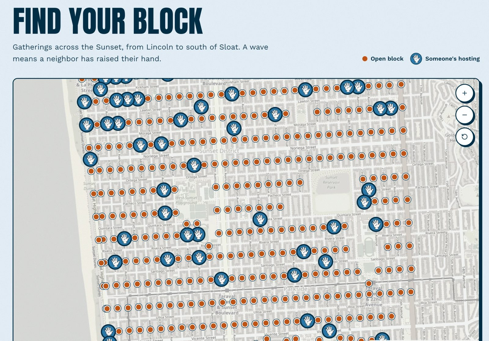

# The Sunset Wave

**[thesunsetwave.org](https://thesunsetwave.org)**: 400 neighbor gatherings on the same day, Saturday, March 20, 2027, across San Francisco's Sunset District.

The Sunset Wave invites a neighbor on every block to raise a hand and host a gathering: coffee and donuts out front, a potluck, a card game in the garage, chalk art and music. This is the inaugural Wave, and we hope it becomes an annual neighborhood tradition. It's organized by the [Sunset Social Club](https://sunsetsocialclub.org), a free neighborhood club run by people who live in the Sunset.

The story behind it: [Can 400 block parties on a single day heal a divided SF neighborhood?](https://sfstandard.com/2026/11/01/the-sunset-wave-is-coming-this-spring/) (The San Francisco Standard)



## The map

Every block is a dot on a real street map. An open dot is waiting for someone. A wave means a neighbor has raised their hand there. The map does two jobs:

- **New hosts sign up for their block or stretch.** Tap an open dot and offer to host in under a minute. Hosting somewhere that isn't a dot (a courtyard, a parklet, a corner)? Describe your stretch and a steward places it.
- **Neighbors reach the host on their block.** Tap a wave and send the host a note ("I live here and could bring chairs"). A steward reads it first, then passes the note and the neighbor's contact on to the host.

Host names and contact details are never shown publicly.

## Where this is going

The day is step one. The idea is that 400 block hosts get to know one another, find out they can host, and then go on to do lots of neighborhood projects together with our neighbors.

Hosts get a party to meet each other before the day, a host network, planning help, flyers by local artists, a little money if they need it, and support on the day.

## What's here

- **Landing page** in English, Mandarin, Cantonese and Spanish
- **Block map** where you find your block and offer to host
- **Notes to hosts** from neighbors, which stewards review before forwarding
- **Contact form** for local businesses, plus a link to tax-deductible donations
- **Steward dashboard** (`/steward`, password-gated) with host signups, exports, traffic, notes, location review and FAQ editing

## How the privacy works

- Visitors can add a host offer, a note or a contact message. They can't read any.
- The public map only learns which blocks are claimed, through database functions that return no names.
- A note never goes straight to a host. A steward approves it, and it is sent once.
- Every steward action re-checks the session on the server.

`AGENTS.md` has the full list of project rules.

## Tech

React 19 · TanStack Start · Vite · Tailwind CSS v4 · Leaflet with OpenStreetMap tiles · Lovable Cloud backend (Postgres). Built with [Lovable](https://lovable.dev).

```sh
npm i
npm run dev
```

```sh
npm test
```

## Make one for your neighborhood

The code is MIT, so fork it. The parts that are about the Sunset:

- `src/lib/blocks.ts`: the grid of avenues and streets, and the gaps for parks and schools
- `src/lib/hosting-streets.json`: street segments and corners, generated from the city's public street centerlines by `scripts/generate-hosting-streets.py`
- `src/lib/i18n.tsx`: every word on the site, one dictionary per language
- `drizzle/`: the database tables and access rules

Block ids stay the same once people have claimed them, so the map can grow without losing anyone.

Not a coder? The Sunset Wave is in the [Relational Builder](https://relationalbuilder.org/gallery) gallery with a starter prompt, "Build: A Host Map for a Day of Gatherings", that asks about your place and builds a lighter version with you.

## License

[MIT](./LICENSE) © 2026 Sunset Social Club
